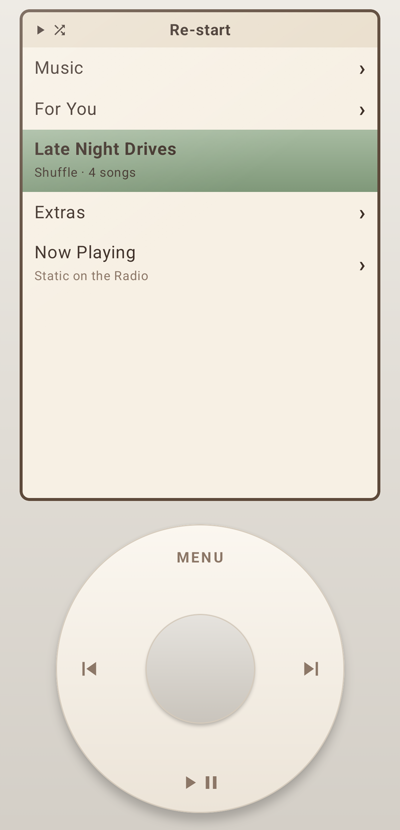
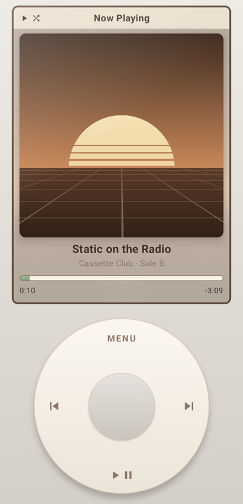
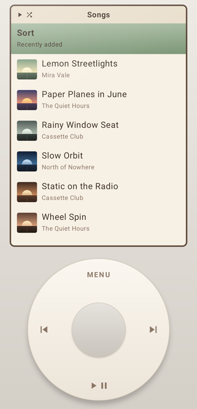
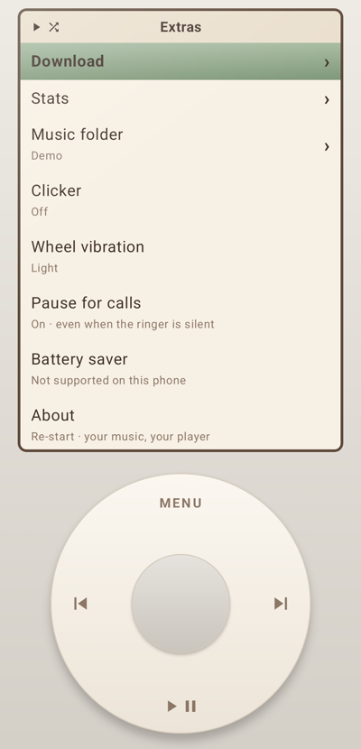

# Re-start

**An old-school music player, reborn on your phone.** Re-start turns your Android phone into a retro click-wheel music player: scroll with the wheel, press the center to choose, MENU to go back. It plays the music on your phone, and finds you new songs from YouTube Music when you want them.

  
  
  
  

## Features

**The wheel**
- Turn it to scroll (faster turns go further), press the center to select, MENU to go back
- On Now Playing, the wheel is the volume; hold ⏮ / ⏭ to rewind or fast-forward
- Light vibration on every step, and an optional click sound

**Your music**
- Plays the songs in one folder of your choice (Music by default)
- Playlists: create, rename, reorder, and pin your favorites to the main menu, where one press shuffles them
- Synced lyrics: press the center on Now Playing (reads `.lrc` files next to your songs)
- Shuffle, repeat, Up Next, and stats on what you play most
- Keeps playing in the background, with lock screen and headphone controls; can pause for phone calls even on silent

**New music** (needs internet)
- **Start Mix** on any song: like YouTube Music's "Start radio". Songs you have play from your phone, the others stream
- **For You**: 30 new songs a day, picked from the radios of the songs you play most
- **Download**: paste a YouTube or YouTube Music link to save a song, with its cover and synced lyrics (from [LRCLIB](https://lrclib.net)), or import a whole playlist

## Install

Download the latest APK from the [Releases](../../releases) page and open it on your phone (Android will ask you to allow installing apps from your browser or file manager).

- Android 7.0 or newer; downloading needs Android 10 or newer
- The APK is large (it carries its own copy of Python, yt-dlp and ffmpeg for the downloader) and works on every kind of Android processor

### First run

1. Allow access to your music.
2. Open **Extras → Music folder** and pick the folder your songs are in.
3. Optional: allow notifications (download progress) and the Phone permission (**Extras → Pause for calls**).

## Build it yourself

1. Install [Android Studio](https://developer.android.com/studio) (it includes the Java version Gradle needs).
2. Clone this repository and open the folder in Android Studio.
3. Press **Run** with your phone connected (USB debugging on) or an emulator.

From a terminal: `./gradlew assembleDebug` builds `app/build/outputs/apk/debug/app-debug.apk`, and `./gradlew testDebugUnitTest` runs the tests.

## How it's built

Kotlin and Jetpack Compose, with [Media3 / ExoPlayer](https://developer.android.com/media/media3) for playback and [Room](https://developer.android.com/training/data-storage/room) for playlists and stats.

| Folder | What's in it |
| --- | --- |
| `app/.../ui/device/` | The player: the click wheel, menus, Now Playing |
| `app/.../playback/` | The background service that plays the music (and streams songs) |
| `app/.../data/` | Finding songs on the phone, playlists and stats (Room), lyrics, mixes, For You |
| `downloader/` | Downloads, playlist imports and YouTube Music lookups, through yt-dlp |

The `downloader` module is separate on purpose: the player itself never needs the internet.

## Disclaimer

Downloading and streaming use [yt-dlp](https://github.com/yt-dlp/yt-dlp), which may go against YouTube's Terms of Service. Use them for music you have the right to listen to and keep. Re-start isn't affiliated with YouTube, Google or Apple.

## Credits

- [yt-dlp](https://github.com/yt-dlp/yt-dlp) and [youtubedl-android](https://github.com/yausername/youtubedl-android) (with ffmpeg) for downloading and streaming
- [LRCLIB](https://lrclib.net) for synced lyrics
- [Media3 / ExoPlayer](https://github.com/androidx/media), Jetpack Compose and Room by Google

## License

[GPL-3.0](LICENSE). You can use, change and share Re-start; if you share a changed version, share its source code under the same license. (The downloader library Re-start includes, youtubedl-android, is GPL-3.0 too, which is why the app as a whole is.)
